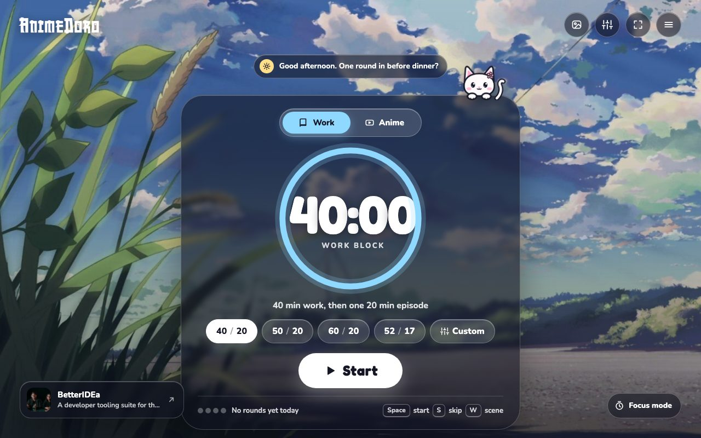
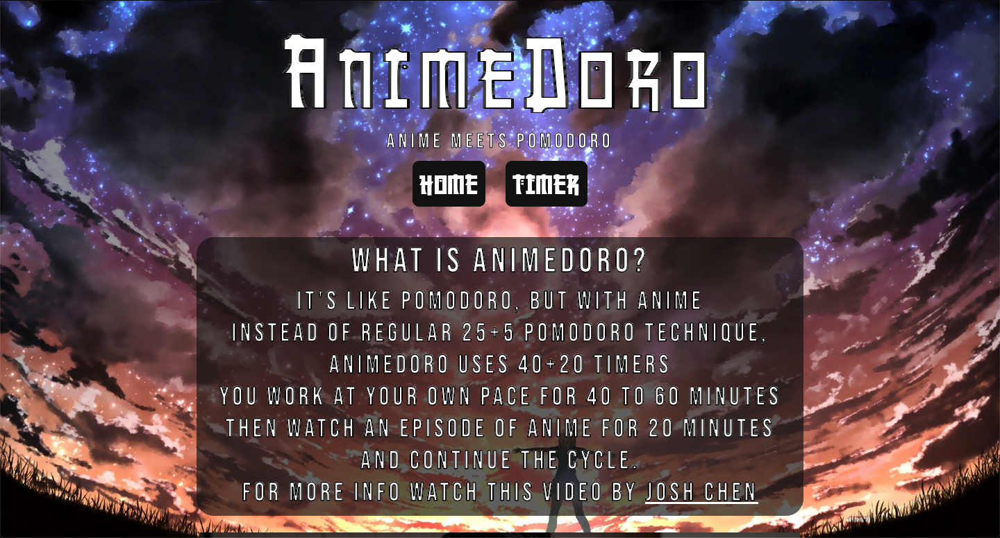
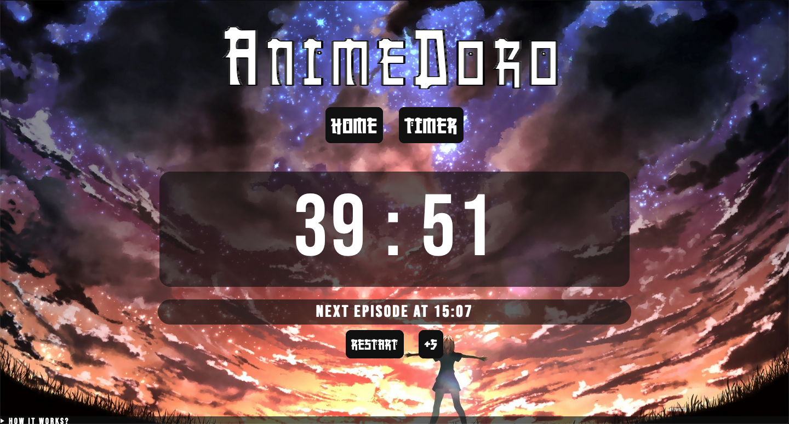
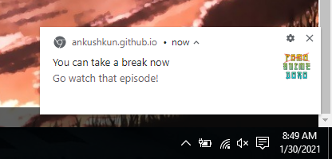

# Animedoro Timer ⏱

## What is AnimeDoro?

It's like **pomodoro**, but with **Anime**
Instead of regular 25+5 pomodoro technique,
you work at your own pace for 40 to 60 minutes
then watch an episode of anime for 20 minutes
and continue the cycle\
**_For more info watch this video by [Josh Chen](https://www.youtube.com/watch?v=bUjGZJIgse0)_**\
productivity : 📈\
You can also set custom time limits if you want.

Use Animedoro [here](https://ankush.one/animedoro-timer/) 👈 😊 (focus mode: [/timer/](https://ankush.one/animedoro-timer/timer/))

## Screenshots

The 2021 version

## The look (2026, "Frosted Sakura")

Smoked frosted glass over 45 animated and still anime scenes, white type, a sky accent for work and a sakura accent for the anime break, squishy pill buttons, and Doro the cat, who blinks, follows your cursor, naps during the episode and cheers when a block ends.

- Fonts: Manga (the wordmark, same as 2021), Fredoka for the digits and headings, Nunito for everything else.
- Glass: dark tints (`rgba(14,16,30,.58)` on panels) with a 1px white edge and a 4 px `backdrop-filter` blur. Pills inside a panel get no blur of their own: nested blurs are what cost.
- The Josh Chen video is a click-to-play facade (self-hosted thumbnail); the YouTube player only loads on click. Append `?perf=1` to any page for a frame meter when chasing a lag report.
- Scenes: 25 animated loops (960x540, 24 fps, H.264 only, about 1 MB each; H.264 is the one codec every browser decodes in hardware) and 21 stills with a slow drift (a transform-only move the GPU composites for free). Loops pause when the tab is hidden or the timer is scrolled out of view. A "Reduce effects" switch in Settings turns loops into their posters and stops the drift, petals and animations; the page flips it on by itself if it sees frames dropping.
- Everything respects `prefers-reduced-motion`.

## Layout

- `index.html` is the home page with the timer and the Animedoro guide, `timer/` is focus mode. Both share `assets/css/app.css` and the scripts in `assets/js/`:
  - `whimsy.js`: toasts, petals, confetti, Doro's eyes.
  - `timer.js`: the timer, presets, rounds and streak, the block-done overlay, keyboard shortcuts.
  - `wallpaper.js`: the scenes (drifting stills, crossfading) and the picker grid in the sheet.
  - `sheet.js`: the Scenes / Music / Settings / More sheet, full screen, M and F keys.
  - `projects.js`: the "From ankush.one" card in focus mode, fed by https://ankush.one/projects-latest.json (built by the portfolio site).
- Adding a wallpaper: for a loop, a 960x540 24 fps H.264 `.mp4` plus a 1280x720 `.jpg` poster in `assets/wallpapers/`; for a still, a 1920x1080 jpg plus a 960x540 `-thumb.jpg` under `stills/`, add it to the `data-loops` / `data-stills` lists in both pages and to `manifest.json`.
- The old URLs (`/Animedoro/` and `/Animedoro/doro/doro.html`) are kept as redirect stubs, so nothing that was ever linked or indexed breaks.
- `.nojekyll`: GitHub Pages serves the files as they are.

## Keyboard

`Space` start or pause · `S` skip · `R` reset · `W` next scene · `M` music · `F` full screen · `Esc` close the sheet

## TODO

- [x] Custom time
- [x] Total time studied/watched anime counter
- [x] Presets, progress ring, tab-title countdown, survives reload
- [x] Browser notification and sound, screen wake lock on phones
- [x] 45 anime wallpapers (25 animated) with a picker and a shuffle button (assets/wallpapers, see CREDITS.md there)
- [x] Rounds today, study streak, block-done celebration, Doro the cat
- [ ] Some login thing for storing timer data
- [ ] Global leaderboards based on study time
- [ ] Browser extension?

#### P.S. : You can also set anime time more than work time 😉

## More from the developers

[Construct](https://construct.computer) — the fastest way to set up AI agents in your business.

---

please check [CONTRIBUTING.md](./CONTRIBUTING.md) 👈
